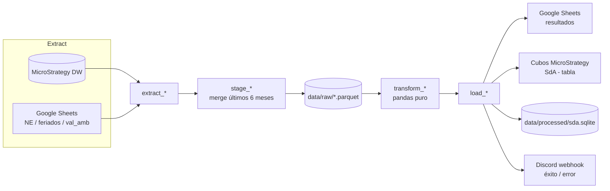
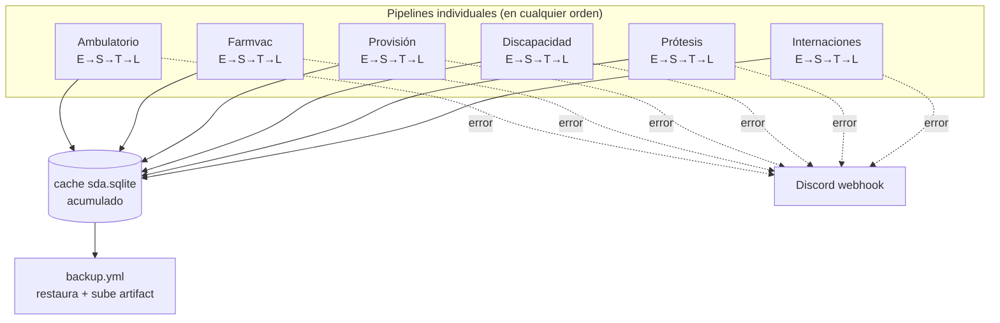

# SdA — Seguimiento de Autorizaciones

Pipeline diario de seguimiento de autorizaciones para una aseguradora de salud. Extrae datos crudos desde un Data Warehouse en **MicroStrategy**, calcula proyecciones diarias y de ejercicio frente a niveles esperados, y publica los resultados en **Google Sheets** en **cubos de MicroStrategy** y en una base **SQLite** local para consulta histórica.

Los pipelines se disparan manualmente desde atajos de iPhone, que llaman a workflows de **GitHub Actions** vía `workflow_dispatch` / `repository_dispatch`.

## Qué calcula

Para cada rubro (Ambulatorio, Farmacia y Vacunas, Discapacidad, Prótesis, Provisión, Internaciones) el pipeline compara lo autorizado realmente contra un **Nivel Esperado** cargado en Google Sheets, y proyecta cómo va a cerrar el mes en curso usando el historial reciente (promedios por día de la semana, ajustados por feriados/días no laborables/turísticos).

## Arquitectura: E → S → T → L

Cada pipeline sigue siempre el mismo patrón de 4 etapas, una carpeta por etapa:

| Etapa | Carpeta | Qué hace | I/O |
|---|---|---|---|
| **E**xtract | `src/extract/` | Trae datos crudos desde MicroStrategy (`mstrio-py`) o tablas auxiliares de Google Sheets | Red |
| **S**tage | `src/stage/` | Persiste/mergea lo extraído en parquet local, manteniendo los últimos 6 meses | `data/raw/*.parquet` |
| **T**ransform | `src/transform/` | Calcula las proyecciones en memoria (pandas puro, sin I/O) | — |
| **L**oad | `src/load/` | Escribe el resultado en Google Sheets, actualiza el cubo de MicroStrategy y guarda un snapshot diario en SQLite | Red + `data/processed/sda.sqlite` |

`src/pipelines/<nombre>.py` orquesta las 4 etapas y notifica éxito/error a Discord.



### Importante: la extracción (E) sólo es necesaria en local o al inicio del job de CI

En GitHub Actions, el paso T→L se ejecuta llamando a `python src/pipelines/<nombre>.py`, que internamente corre sólo `_run_tl()` — **no toca MicroStrategy**. Las credenciales `MSTR_USER` / `MSTR_PASSWORD` se necesitan en el paso E→S y también en T→L, porque `load_*` actualiza los cubos de MicroStrategy. Para uso local, la función `run()` de cada pipeline hace el ciclo completo E→S→T→L.

## Pipelines disponibles

| Pipeline | Reportes / fuentes | Tabs escritos en Google Sheets |
|---|---|---|
| `ambulatorio` | Reports Ambulatorio + Resto (MSTR) + NE_amb, feriados, val_amb (Sheets) | `amb_seg_diario`, `amb_general`, `amb_resto`, `amb_medidas` |
| `farmvac` | Reports Farmacia + Vacunas (MSTR) + NE_farm (Sheets) | `farmvac_seg_diario`, `farmvac_gral_Q`, `farmvac_gral_imp`, `farm_proy_imp_diario` |
| `discapacidad` | Report Discapacidad (MSTR) + tabla auxiliar de mapeo | `discapacidad` |
| `protesis` | Report Prótesis (MSTR) | `protesis` |
| `provision` | Reports Provisión + Provisión diario + NC Droguerías (MSTR) + NE_provision, NE_provisionNC (Sheets) | `prov_gral`, `prov_diario`, `NC`, `drogueria` |
| `internaciones` | Reports Sanatorial + Quirúrgicas (MSTR) | `sanatorial`, `quirurgicas`, `consolidado_sanatorial`, `consolidado_quirurgicas` |
| `check_dw` *(no es E→S→T→L)* | Tabla de control de procesos del DW + cubos de MicroStrategy (`fetch_cubos_info`) | — (notifica a Discord en **dos mensajes separados**: estado del DW y estado de cubos) |

Todas las salidas también se snapshotean diariamente en `data/processed/sda.sqlite` (una tabla por tab de Sheets, con columna `fecha_carga`).

Los 6 pipelines se disparan **de forma independiente** (en el orden que se quiera, vía Shortcuts) — no hay un workflow que los corra todos en un único job. Cada uno, además de escribir a Sheets, restaura y actualiza un cache compartido de `sda.sqlite` para que el historial se vaya acumulando entre corridas. `backup` (`.github/workflows/backup.yml`) es un workflow liviano, sin ninguna extracción, que se dispara al final de la secuencia diaria para restaurar ese cache acumulado y subirlo como artifact de respaldo.



## Cubos de MicroStrategy

Además de Sheets, cada tabla de salida se publica en un **super cube** de MicroStrategy (carpeta "Cubos SdA"), llamado `SdA - <table_name>`. Son 15 cubos, uno por tabla, menos las 3 acumulativas (`farm_proy_imp_diario`, `consolidado_sanatorial`, `consolidado_quirurgicas`), que no se suben.

| Pipeline | Cubos (`table_name`) |
|---|---|
| `ambulatorio` | `amb_seg_diario`, `amb_general`, `amb_resto`, `amb_medidas` |
| `farmvac` | `farm_seg_diario`, `farm_gral_q`, `farm_gral_imp` |
| `discapacidad` | `discapacidad` |
| `protesis` | `protesis` |
| `provision` | `prov_gral`, `prov_diario` (sin `Proyección Importe`, igual que la hoja), `prov_nc`, `prov_drogueria` |
| `internaciones` | `internaciones_sanatorial`, `internaciones_quirurgicas` |

- **Cómo se suben:** cada `load_*` llama a `subir_tabla(df, table_name)` (`src/load/cubo.py`), que actualiza el cubo con política `replace`. Usa la librería [smpy](https://github.com/maxsosa-ss/strategic-management) (`dataframe_to_supercube`), instalada desde GitHub y fijada a un commit en `requirements.txt`.
- **IDs:** `config/cubos.json` guarda `{table_name: cube_id}`. Se commitea, porque en Actions el archivo no se escribe de vuelta.
- **Un fallo del cubo nunca frena el pipeline:** avisa con un warning a Discord y sigue. Las hojas y SQLite ya se escribieron antes.
- **Tipos:** `_para_cubo` convierte todas las columnas numéricas a `float64`, `Periodo` a texto y las fechas a `datetime64[ns]`. Esto es importante: el cubo fija el tipo de cada métrica al crearse. Una métrica `integer` es de 32 bits, y actualizarla con importes mayores (o con otro tipo) la deja **nula sin dar error**. Con `float64` la métrica es siempre `double`. Si hay que cambiar el tipo de una métrica, hay que borrar y recrear el cubo.
- **Crear cubos nuevos (sólo local):** con `CREAR_CUBOS=1`, `subir_tabla` crea el cubo de una tabla que no esté en `cubos.json` y guarda su ID; después hay que commitear el archivo. En Actions nunca se crea nada (cada corrida crearía un duplicado) y un cubo sin ID registrado sólo genera un warning.

## Estructura del repositorio

```
src/
  extract/      # pull desde MicroStrategy o Google Sheets
  stage/        # merge en parquet local (data/raw/*.parquet), retiene 6 meses
  transform/    # cálculo de proyecciones, pandas puro, sin I/O
  load/         # escritura a Google Sheets + cubos de MicroStrategy (cubo.py) + snapshot en SQLite
  pipelines/    # orquestación E→S→T→L + notificaciones Discord
  utils/        # conexiones (MSTR/Google), fechas, Discord, helpers de Sheets, mapeos
config/
  cubos.json    # {table_name: cube_id} de los cubos de MicroStrategy (se commitea)
scripts/
  check_dw.py   # chequea última actualización de procesos del DW
data/
  raw/          # parquets de staging (uno por pipeline; ambulatorio tiene además ambulatorio_resto.parquet)
  processed/    # sda.sqlite — snapshots históricos
.github/workflows/  # un workflow por pipeline + backup.yml
main.ipynb      # notebook para correr todos los pipelines en local
```

## Cómo correr en local

### 1. Setup

```bash
pip install -r requirements.txt
```

Variables de entorno (en `.env` o exportadas):

```
MSTR_USER=...
MSTR_PASSWORD=...
DISCORD_WEBHOOK_URL=...   # opcional en local
```

Credenciales de Google: archivo `credentials.json` (service account) en la raíz del repo.

La librería `smpy` (cubos) se instala con el resto desde `requirements.txt`; el repo `maxsosa-ss/strategic-management` tiene que ser accesible (hoy es público).

### 2. Ejecutar un pipeline completo (E→S→T→L)

```bash
PYTHONPATH=. python -c "from src.pipelines.ambulatorio import run; run()"
```

O abrir `main.ipynb`, que tiene una celda por pipeline llamando a `run()`.

> **Cuidado al probar en local:** `run()` hace E→S→T→L y **escribe en las hojas y en los cubos de producción**. Correr sólo T→L (`python src/pipelines/<nombre>.py`) usa los parquets de `data/raw/`, que en local pueden estar desactualizados, y publicaría datos viejos. Para probar sin tocar las hojas, usar `SOLO_CUBOS=1` (`escribir_tabla_df` no escribe nada, pero los cubos y SQLite sí se actualizan) y refrescar los datos con `run()`:
>
> ```bash
> SOLO_CUBOS=1 PYTHONPATH=. python -c "from src.pipelines.ambulatorio import run; run()"
> ```
>
> Los parquets de `data/raw/` están versionados: después de una prueba local, restaurarlos con `git checkout -- data/raw` para que no entren a un commit.

### 3. Ejecutar sólo una etapa

```bash
# Sólo re-extraer y stagear el historial reciente (E→S)
PYTHONPATH=. python -c "
from src.extract.ambulatorio import extract_u6m, extract_resto
from src.stage.ambulatorio import stage_u6m, stage_resto
stage_u6m(extract_u6m())
stage_resto(extract_resto())"

# Sólo verificar el estado del DW
PYTHONPATH=. python scripts/check_dw.py
```

Para Ambulatorio también hay targets de `Makefile` (`make sync-complete`, `make sync-u6m`, `make run-ambulatorio`).

No hay tests automatizados — la verificación se hace corriendo el pipeline end-to-end e inspeccionando la salida en Google Sheets.

### Notas sobre el staging

- Los parquets de `data/raw/` deben existir antes de poder usar el modo incremental (`stage_u6m` / equivalentes). Si no existen, hay que correr primero la versión "complete" del extract+stage para bootstrapear el historial.
- El filtro de fecha es siempre `df['Fecha'] < hoy` — los datos de hoy se excluyen de los cálculos aunque ya estén en el parquet.

## Cómo correr en GitHub Actions

Cada pipeline tiene su propio workflow en `.github/workflows/`, disparable manualmente (`workflow_dispatch`) o vía `repository_dispatch` con un `type` específico (usado por los atajos de iPhone):

| Workflow | `repository_dispatch` type |
|---|---|
| `ambulatorio.yml` | `actualizar-ambulatorio` |
| `farmvac.yml` | `actualizar-farmvac` |
| `discapacidad.yml` | `actualizar-discapacidad` |
| `protesis.yml` | `actualizar-protesis` |
| `provision.yml` | `actualizar-provision` |
| `internaciones.yml` | `actualizar-internaciones` |
| `check_dw.yml` | `check-dw` |
| `backup.yml` | `backup-sqlite` |

Cada job de pipeline:
1. Instala dependencias y restaura un cache del parquet (best-effort).
2. Restaura el cache acumulado de `data/processed/sda.sqlite`.
3. Escribe `credentials.json` desde el secret `GOOGLE_CREDENTIALS`.
4. Corre el extract+stage (E→S) usando `MSTR_USER` / `MSTR_PASSWORD`.
5. Corre `python src/pipelines/<nombre>.py` (T→L), que escribe a Sheets, actualiza los cubos de MicroStrategy (con `MSTR_USER` / `MSTR_PASSWORD`) y SQLite, y notifica éxito por Discord. Al terminar el job, el cache guarda el `sda.sqlite` actualizado.
6. Si falla cualquier paso, notifica el error a Discord con un link al run.

`backup.yml` no corre ninguno de estos pasos: solo restaura el cache de `sda.sqlite` y lo sube como artifact. Conviene dispararlo al final de la secuencia diaria de pipelines para tener un respaldo descargable del historial acumulado.

### Secrets requeridos

| Secret | Uso |
|---|---|
| `MSTR_USER` / `MSTR_PASSWORD` | Login a MicroStrategy (paso E→S y actualización de cubos en T→L) |
| `GOOGLE_CREDENTIALS` | JSON completo de la service account de Google |
| `DISCORD_WEBHOOK_URL` | Notificaciones de éxito/error |

### Google Sheets de salida

| Sheet ID | Pipeline |
|---|---|
| `1x0vover_16Q-XQZfJgeGBkfpi_R44PVO7y2x7U8Kz1Y` | ambulatorio |
| `1DNpmKUjIOuHPCBrMN8Ww5xlmJ1XQAvGcH3wMFujvMNU` | farmvac |

(IDs de Sheets de entrada/auxiliares en cada módulo de `src/extract/`.)

> **Nota**: el cache de parquet en CI está keyado por fecha UTC (`YYYYMMDD`), no por `github.run_id`. Esto significa que si un mismo pipeline se vuelve a disparar el mismo día, reusa el parquet cacheado y se saltea la extracción desde MicroStrategy; un día nuevo siempre fuerza una extracción fresca.
>
> El cache de `sda.sqlite`, en cambio, está keyado por fecha **y** `github.run_id` (`sqlite-<fecha>-<run_id>`, con `restore-keys: sqlite-`), así que nunca hay un hit exacto: cada corrida siempre restaura el estado más reciente y siempre guarda sus cambios de vuelta, permitiendo que el historial se acumule sin importar cuántas veces se corra un pipeline en el día.

## Resiliencia ante errores transitorios

- Los fetches a MicroStrategy (`_fetch` en cada `src/extract/*.py`) reintentan hasta 3 veces ante `ConnectionError`, vía `tenacity`.
- Las lecturas/escrituras a Google Sheets (`leer_tabla_df` / `escribir_tabla_df` en `src/utils/gc_functions.py`) reintentan hasta 3 veces ante errores transitorios (caídas de conexión, timeouts, HTTP 429/5xx).
- Las tablas auxiliares de `src/utils/mapping.py` se cargan de forma perezosa (en el primer uso), no al importar el módulo — así un error transitorio de Sheets no rompe el `import` de módulos que dependen de él.
